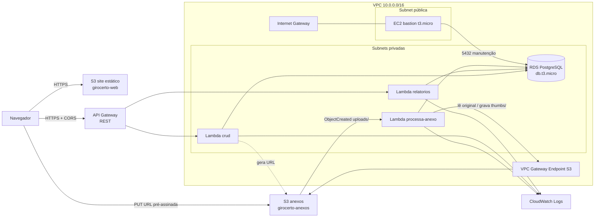
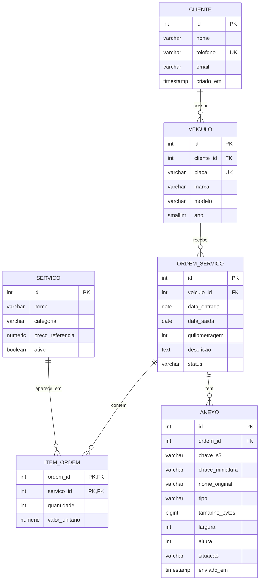

# GiroCerto - Design

## Arquitetura



Fluxo principal:

1. O front é servido pelo bucket `girocerto-web-5j11` com hospedagem de site estático (`index.html` é a landing page e `app.html` a tela de cadastros).
2. O front chama a API no API Gateway, que encaminha para a Lambda `crud` (recurso `/{proxy+}`) ou `relatorios` (recurso `/relatorios/{proxy+}`, que tem precedência por ser mais específico).
3. As Lambdas rodam nas subnets privadas e acessam o RDS pelo endpoint DNS.
4. Para anexar um arquivo, o front pede `POST /ordens/{id}/anexos/upload-url`, recebe a URL pré-assinada e faz o PUT direto no bucket `girocerto-anexos`.
5. O evento `ObjectCreated` em `uploads/` dispara a Lambda `processa-anexo`, que acessa o S3 pelo Gateway Endpoint (sem NAT), gera a miniatura e grava os metadados no RDS.

Todas as Lambdas usam a `LabRole`. Não há NAT Gateway.

## Rede

| Recurso | CIDR | AZ | Uso |
|---------|------|----|-----|
| VPC girocerto-vpc | 10.0.0.0/16 | - | - |
| subnet-publica-a | 10.0.1.0/24 | us-east-1a | bastion |
| subnet-privada-a | 10.0.11.0/24 | us-east-1a | RDS, Lambdas |
| subnet-privada-b | 10.0.12.0/24 | us-east-1b | RDS, Lambdas |

| Tabela de rotas | Subnets | Rotas |
|-----------------|---------|-------|
| rt-publica | subnet-publica-a | `10.0.0.0/16` local; `0.0.0.0/0` → Internet Gateway `girocerto-igw` |
| rt-privada | subnet-privada-a, subnet-privada-b | `10.0.0.0/16` local; prefix list do S3 → Gateway Endpoint |

A tabela de rotas privada não tem rota para a internet, apenas a rota local e a do Gateway Endpoint do S3. Por isso nada nas subnets privadas é alcançável de fora, e o RDS também é criado com `Publicly accessible = No`. Não há NAT Gateway. O DB subnet group usa as duas subnets privadas, porque o RDS exige pelo menos duas AZs.

## Security Groups

| SG | Entrada | Saída |
|----|---------|-------|
| sg-lambda | nenhuma | 5432 para sg-rds; 443 para o prefix list do S3 |
| sg-rds | 5432 de sg-lambda; 5432 de sg-bastion | nenhuma regra necessária |
| sg-bastion | 22 do IP do aluno (/32), ajustado a cada sessão | 5432 para sg-rds; 80 e 443 para a internet (instalar o cliente `psql` com `dnf`) |

O RDS é criado com `Publicly accessible = No`.

Como a aplicação chega ao banco: o navegador nunca fala com o RDS. Ele chama o API Gateway, que invoca a Lambda `crud`. A Lambda roda com uma interface de rede nas subnets privadas usando o `sg-lambda`, e o `sg-rds` só aceita a porta 5432 vinda de `sg-lambda` ou `sg-bastion`. A regra é por referência de SG, não por IP, então continua valendo quando a Lambda ou o bastion mudam de endereço. A conexão usa TLS, validado com o certificado da AWS que vai no pacote da Lambda.

## Modelo de dados



Regras no banco:

- `veiculo.cliente_id` e `ordem_servico.veiculo_id` com `ON DELETE RESTRICT`, que garante o bloqueio de exclusão das HU-01 e HU-02.
- `item_ordem` com chave primária composta, o que impede o mesmo serviço duas vezes na mesma ordem (aumenta-se a quantidade).
- `CHECK (status IN ('ABERTA','EM_ANDAMENTO','CONCLUIDA','CANCELADA'))`.
- `CHECK (categoria IN ('MOTOR','FREIO','SUSPENSAO','ELETRICA','REVISAO','OUTROS'))`.
- `CHECK` do formato da placa (antigo ou Mercosul) e `UNIQUE` em `cliente.telefone` e `veiculo.placa`. A API também valida, mas o banco garante a regra mesmo para quem acessa pelo bastion.
- `item_ordem` e `anexo` usam `ON DELETE CASCADE` a partir da ordem: excluir uma ordem ABERTA leva junto seus itens.
- `CHECK (preco_referencia > 0)` e `CHECK (quantidade > 0)`.
- `anexo.situacao` começa como `PENDENTE` e a Lambda muda para `PROCESSADO` ou `ERRO`.

## Rotas da API

Base: `https://{api-id}.execute-api.us-east-1.amazonaws.com/prod`

| Método | Rota | Descrição | HU |
|--------|------|-----------|----|
| GET | /clientes?busca= | Lista e busca clientes | 01 |
| POST | /clientes | Cria cliente | 01 |
| GET | /clientes/{id} | Detalhe com veículos | 01, 02 |
| PUT | /clientes/{id} | Atualiza cliente | 01 |
| DELETE | /clientes/{id} | Exclui (409 se houver veículos) | 01 |
| GET | /veiculos?clienteId= | Lista veículos | 02 |
| POST | /veiculos | Cria veículo | 02 |
| PUT | /veiculos/{id} | Atualiza veículo | 02 |
| DELETE | /veiculos/{id} | Exclui (409 se houver ordens) | 02 |
| GET | /servicos | Lista catálogo | 04 |
| POST | /servicos | Cria serviço | 04 |
| PUT | /servicos/{id} | Atualiza ou desativa | 04 |
| DELETE | /servicos/{id} | Exclui (409 se já usado) | 04 |
| GET | /ordens?status=&veiculoId= | Lista ordens | 03 |
| POST | /ordens | Abre ordem | 03 |
| GET | /ordens/{id} | Detalhe com itens, total e anexos | 03, 05 |
| PUT | /ordens/{id} | Atualiza dados e status | 03 |
| DELETE | /ordens/{id} | Exclui ordem ABERTA | 03 |
| POST | /ordens/{id}/itens | Adiciona serviço | 03 |
| DELETE | /ordens/{id}/itens/{servicoId} | Remove serviço | 03 |
| POST | /ordens/{id}/anexos/upload-url | Gera URL pré-assinada | 05 |
| GET | /ordens/{id}/anexos | Lista anexos com URL de leitura | 05 |
| GET | /relatorios/faturamento-mensal?inicio=&fim= | Faturamento por mês | 06 |
| GET | /relatorios/servicos-mais-realizados?inicio=&fim= | Top 10 serviços | 06 |

Códigos de resposta: 200, 201, 204, 400 (validação), 404, 405 (método não suportado na rota), 409 (conflito de unicidade, exclusão bloqueada ou ordem fechada). Erros voltam como `{"erro": "mensagem"}`.

Também existe `GET /veiculos/{id}`, que devolve o veículo com o histórico de ordens (HU-02).

Os campos do JSON usam camelCase (`clienteId`, `precoReferencia`, `valorUnitario`). `PUT` aceita só os campos que mudam; o restante é mantido.

O schema está em `sql/01_schema.sql` e os dados de exemplo em `sql/02_seed.sql`.

Exemplo de consulta do relatório de faturamento:

```sql
SELECT date_trunc('month', o.data_saida) AS mes,
       COUNT(DISTINCT o.id) AS ordens,
       SUM(i.quantidade * i.valor_unitario) AS total
FROM ordem_servico o
JOIN item_ordem i ON i.ordem_id = o.id
WHERE o.status = 'CONCLUIDA'
  AND o.data_saida BETWEEN :inicio AND :fim
GROUP BY mes
ORDER BY mes;
```

## ADRs

### ADR-001 - CRUD em Lambda ou em container (RNF-04)

**Status:** aceito

**Contexto.** O CRUD precisa acessar o RDS na subnet privada e ficar disponível de novo a cada sessão do Learner Lab. A sessão expira, o IP público da EC2 muda ao reiniciar e o orçamento é limitado. As outras partes do sistema (relatório e processamento de anexos) já serão Lambda por exigência do enunciado.

**Opções.**

1. Lambda atrás do API Gateway.
2. API em container Docker numa EC2 t3.micro.
3. ECS Fargate.

**Decisão.** Lambda atrás do API Gateway, com uma única função `crud` que roteia pelo método e caminho.

**Motivos.**

- O endpoint do API Gateway não muda entre sessões, então o front não depende de IP (RNF-03). Com EC2 seria preciso Elastic IP ou atualizar a configuração a cada sessão.
- Não há servidor ligado quando ninguém usa, o que economiza o crédito do Lab.
- O sistema inteiro fica num único modelo de deploy, igual às Lambdas de relatório e de anexo.
- O volume de uso é baixo, então cold start e limite de conexões não são problema prático.

**Consequências.**

- Cada Lambda abre conexão com o RDS. A conexão é criada fora do handler para ser reaproveitada entre invocações quentes; se o número de conexões virar problema, avaliar RDS Proxy.
- A primeira requisição depois de um tempo parado pode levar de 1 a 3 segundos.
- A Lambda na VPC não tem internet; dependências precisam ir no pacote ou numa layer.
- Teste local fica um pouco mais trabalhoso do que com um container.

### ADR-002 - Banco de dados

**Status:** aceito

**Decisão.** PostgreSQL no RDS, `db.t3.micro`, 20 GB gp3, sem Multi-AZ.

**Motivos.** O grupo já usou PostgreSQL no Projeto 1, o modelo é relacional com JOINs e o tamanho mínimo cabe no orçamento. Multi-AZ dobraria o custo sem ganho para um projeto acadêmico.

### ADR-003 - Upload direto para o S3

**Status:** aceito

**Decisão.** O arquivo vai do navegador para o S3 por URL pré-assinada de PUT, válida por 5 minutos e restrita ao `Content-Type` informado. O backend só gera a URL e registra o anexo como `PENDENTE`.

**Motivos.** O API Gateway limita o corpo da requisição a 10 MB e a Lambda a 6 MB de payload síncrono; passar o arquivo pela API não funcionaria para fotos maiores. Também evita gastar tempo de Lambda transferindo bytes.

### ADR-004 - Front-end

**Status:** aceito

**Decisão.** HTML, CSS e JavaScript sem framework, publicados como site estático no S3.

**Motivos.** Não exige build nem servidor, e o deploy é um `aws s3 sync`. A URL da API fica num `config.js` gerado no deploy, atendendo ao RNF-03.

### ADR-005 - Linguagem e driver da Lambda

**Status:** aceito

**Decisão.** Python 3.12 com o driver `pg8000`.

**Motivos.** A Lambda na VPC não tem internet, então as dependências vão no `.zip`. O `pg8000` é Python puro: o pacote gerado em macOS ou Windows funciona na Lambda (Linux) sem compilar nada, ao contrário do `psycopg2`, que precisa de binário específico. O `scripts/empacotar-crud.sh` monta o pacote.

### ADR-006 - Uma Lambda com rota proxy no API Gateway

**Status:** aceito

**Decisão.** Um único recurso `/{proxy+}` com método `ANY` e integração proxy para a Lambda `crud`, que faz o roteamento internamente. A Lambda também responde o `OPTIONS` com os cabeçalhos CORS.

**Motivos.** Criar pelo console um recurso e um método para cada uma das 21 rotas de CRUD tomaria tempo e seria fácil de errar ao recriar (RNF-05). Com o proxy, o API Gateway tem um único método, e as rotas ficam versionadas no código. A desvantagem é que o API Gateway não valida os caminhos, então a Lambda devolve 404 e 405 por conta própria.
